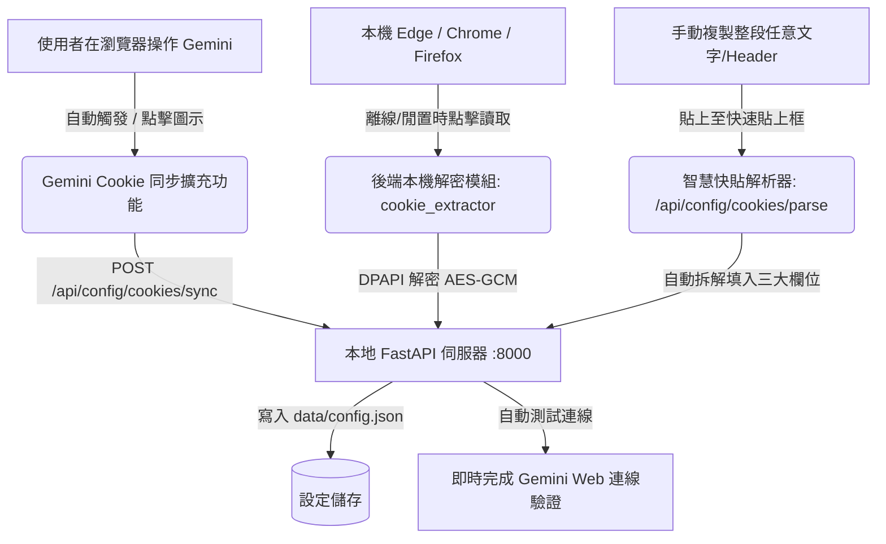

# Google Gemini Cookie 自動讀取與同步功能說明文件

本文件詳細說明 AI 智能對話助手針對 **Google Gemini 網頁版（Web API）Cookie 自動提取、背景靜默同步與智慧快速解析** 的完整實作機制與操作指引。

---

## 1. 痛點分析與解決方案

### 1.1 原有痛點
- Google Gemini 網頁版的 `__Secure-1PSIDTS` 與 `__Secure-1PSIDCC` 具有有效期限，一段時間後會失效，導致對話出現 `UNAUTHENTICATED` 錯誤。
- 每次手動至瀏覽器開發者工具（F12 -> Application -> Cookies）複製 3 個長字串非常繁瑣且容易遺漏或貼錯欄位。
- 由於 `__Secure-1PSID` 具備 `HttpOnly` 安全旗標，網頁端 JavaScript（如書籤小工具 Bookmarklet）受到瀏覽器安全限制無法直接透過 `document.cookie` 讀取。
- 本機 Chromium 瀏覽器（Edge / Chrome）在運行狀態下，會對 SQLite Cookie 資料庫進行作業系統層級的獨佔鎖定。

### 1.2 三軌並行解決方案

本系統設計了 **「全自動瀏覽器擴充功能 + 本機資料庫解密直讀 + 智慧剪貼簿自動解析」** 三軌並行的極致解決方案：



---

## 2. 方案一：專屬瀏覽器擴充功能（最推薦，全自動無感同步）

專屬擴充功能位於專案目錄 `extensions/gemini-cookie-sync/`，採用最新 **Chrome Extensions Manifest V3** 規範。

### 2.1 運作特色
- **免手動複製**：擴充功能具備原生 `cookies` API 權限，可直接合法讀取包含 `HttpOnly` 在內的 Google Cookie。
- **背景靜默同步**：每當使用者造訪或刷新 `https://gemini.google.com`，擴充功能會在背景自動辨識最新 Cookie，並默默同步至本地伺服器 `http://127.0.0.1:8000`。
- **一鍵手動同步**：點擊瀏覽器工具列上的同步圖示，提供直觀的狀態指示燈（已就緒 / 未找到）與「⚡ 立即同步到本機 AI 助手」按鈕。

### 2.2 安裝步驟（僅需 1 分鐘，只需做一次）
1. 打開瀏覽器擴充功能管理頁面：
   - **Microsoft Edge**：網址列輸入 `edge://extensions`
   - **Google Chrome**：網址列輸入 `chrome://extensions`
2. 開啟右上角 **「開發人員模式」** 開關。
3. 點擊左上角 **「載入未封裝項目」**（Load unpacked）。
4. 選擇專案資料夾：
   `c:\WorkFolder\MyProject\ai-chat-app\extensions\gemini-cookie-sync`
5. 完成！在瀏覽器擴充功能清單中可將「Gemini Cookie 同步器」釘選至工具列。

---

## 3. 方案二：本機瀏覽器 Cookie 自動直讀（本機解密）

後端內建 `core/cookie_extractor.py` 模組，直接對 Windows 上的 Edge / Chrome / Brave 資料庫進行提取：
1. 讀取瀏覽器 `User Data/Local State` 檔案中的 DPAPI 加密主金鑰。
2. 調用 Windows DPAPI (`win32crypt.CryptUnprotectData`) 解密得到 AES-256 主金鑰。
3. 掃描所有設定檔目錄（`Default`, `Profile 1`, `Profile 2` ...）。
4. 使用 AES-GCM-128 解密 `Network/Cookies` 資料庫中的 `encrypted_value`。
5. **注意事項**：若當前瀏覽器正開啟且開啟了獨佔檔案鎖定，系統會友好提示並建議使用方案一的擴充功能，或將瀏覽器短暫重開後再次點擊。

---

## 4. 方案三：智慧快速貼上自動解析（Smart Paste）

在「模型與語音設定」彈窗的「Google Gemini 網頁版」區塊中，提供了 **「📋 智慧解析快速貼上」** 文字方塊：
- 使用者無論從 F12 Request Headers 複製了 `Cookie: __Secure-1PSID=...; __Secure-1PSIDTS=...`，或是直接一次貼上三行雜湊字串，系統皆會：
  - 前端與後端正則雙重比對，精準分離出 `__Secure-1PSID`、`__Secure-1PSIDTS` 與 `__Secure-1PSIDCC`。
  - 自動填入下方的三個對應輸入框。
  - 跳出綠色成功提示：「✨ 成功識別並填入 3 個 Cookie 項目！」。

---

## 5. 後端 API 規格

### 5.1 `POST /api/config/cookies/sync`
- **用途**：供瀏覽器擴充功能或第三方小工具即時推送 Cookie 更新。
- **請求格式** (JSON)：
  ```json
  {
    "secure_1psid": "g.a000...",
    "secure_1psidts": "sidts-...",
    "secure_1psidcc": "AKEyXz...",
    "raw_cookie": "選填，整段未處理字串",
    "source": "manual_popup 或 auto"
  }
  ```
- **回應格式**：
  ```json
  {
    "status": "ok",
    "message": "Cookie 同步成功！",
    "cookies_updated": ["gemini_web_secure_1psid", "gemini_web_secure_1psidts", "gemini_web_secure_1psidcc"],
    "test_result": { "success": true, "message": "連線成功", "models": ["gemini-flash", "gemini-pro"] }
  }
  ```

### 5.2 `POST /api/config/cookies/detect-from-browser`
- **用途**：觸發本機 Edge / Chrome / Brave Cookie 掃描與解密。
- **回應格式**：
  ```json
  {
    "success": true,
    "message": "成功從本機 Edge (Default) 讀取最新 Gemini Cookie！",
    "cookies": {
      "__Secure-1PSID": true,
      "__Secure-1PSIDTS": true,
      "__Secure-1PSIDCC": true
    },
    "test_result": { ... }
  }
  ```

### 5.3 `POST /api/config/cookies/parse`
- **用途**：傳入任意長文字，自動擷取目標 Cookie 字典。
- **請求格式**：
  ```json
  { "raw_text": "任意貼上的文字內容..." }
  ```
- **回應格式**：
  ```json
  {
    "parsed": {
      "__Secure-1PSID": "...",
      "__Secure-1PSIDTS": "...",
      "__Secure-1PSIDCC": "..."
    },
    "count": 3
  }
  ```

---

## 6. 版本紀錄與檔案清單

| 檔案路徑 | 說明 |
| :--- | :--- |
| `core/cookie_extractor.py` | 本機 Chromium DPAPI 解密與 Cookie 字串解析核心邏輯 |
| `server.py` | 掛載 CORSMiddleware 與 Cookie 同步、偵測、解析 API 端點 |
| `static/index.html` | 前端設定面板整合自動讀取按鈕、擴充功能指引與智慧快貼區 |
| `static/css/style.css` | 玻璃擬態 Cookie 操作面板樣式與狀態反饋標籤 |
| `static/js/app.js` | 自動讀取、防抖快速貼上與連線測試即時聯動邏輯 |
| `extensions/gemini-cookie-sync/manifest.json` | 瀏覽器擴充功能清單設定檔 (Manifest V3) |
| `extensions/gemini-cookie-sync/background.js` | 擴充功能背景 Service Worker（自動監聽分頁與 Cookie 變更） |
| `extensions/gemini-cookie-sync/popup.html` | 擴充功能精美深色彈窗介面 |
| `extensions/gemini-cookie-sync/popup.js` | 擴充功能彈窗手動同步與狀態檢查邏輯 |
| `extensions/gemini-cookie-sync/icon.png` | 擴充功能專屬漸層同步圖示 |
| `docs/GEMINI_COOKIE_AUTO_SYNC.md` | 本功能之架構與操作說明文件 |
